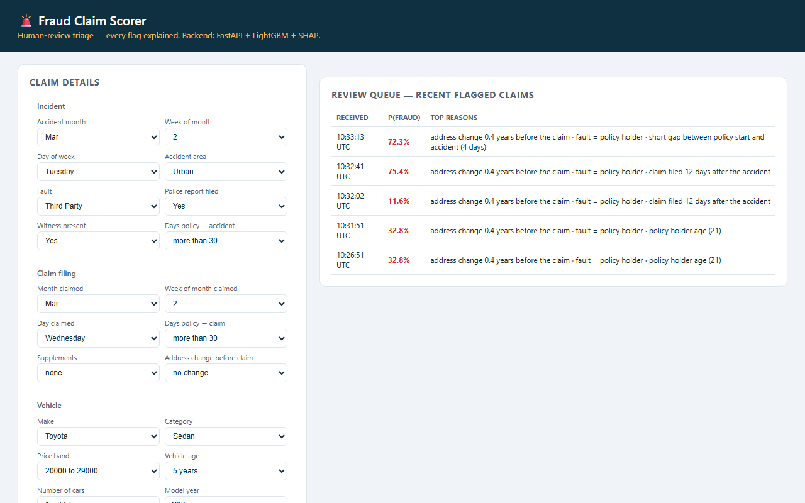
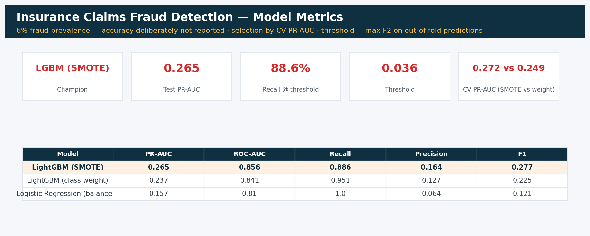
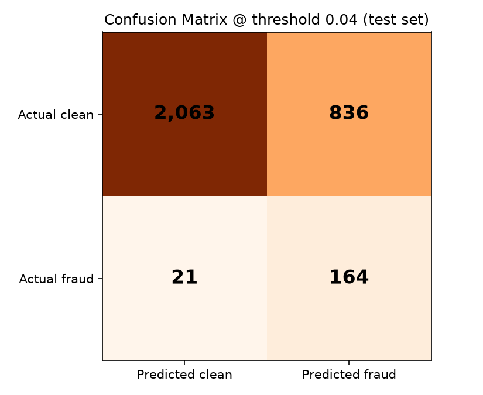
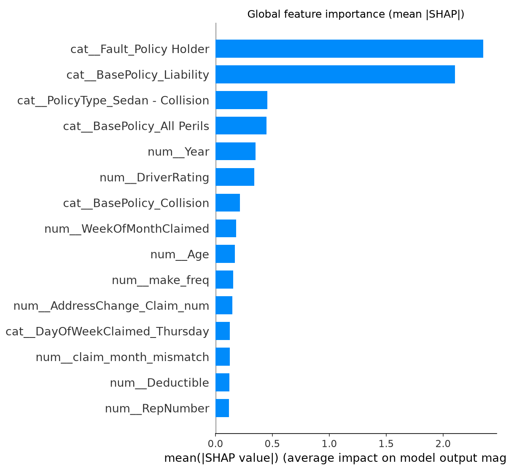
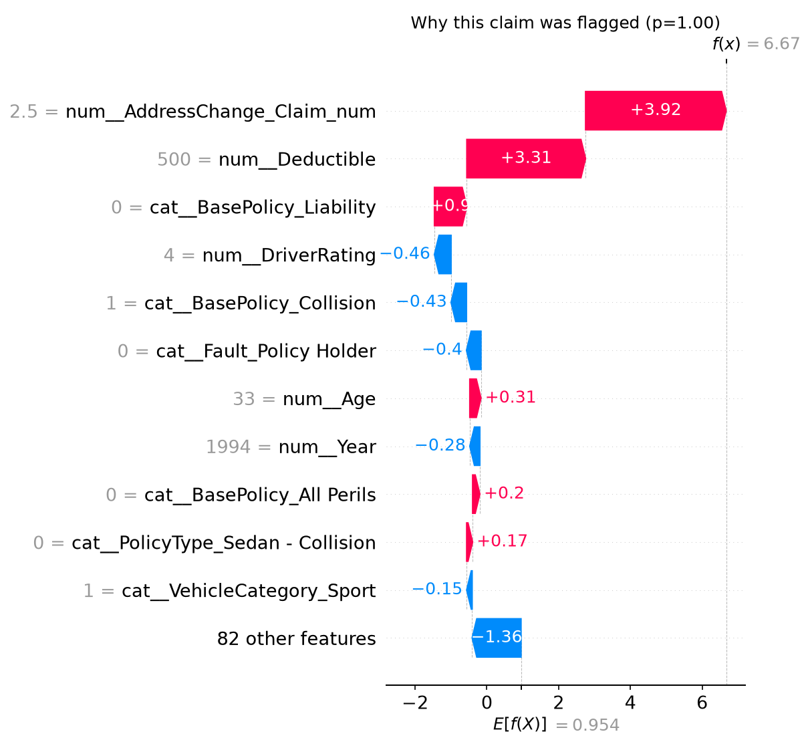

# 🚨 Insurance Claims Fraud Detection

A fraud-scoring API that flags suspicious vehicle-insurance claims for human
review — with **SHAP explainability**, so an analyst sees *why* a claim was
flagged, not just a score.



*Built-in analyst UI (plain HTML/JS served by FastAPI): suspicious claim → flagged with reasons; clean claim → cleared. Note the derived fields — contradictory inputs are impossible by construction.*




## Business framing

Insurance fraud sits on a brutally asymmetric cost curve: a missed fraudulent
claim (false negative) costs the full payout — often thousands of dollars —
while a false alarm costs a few minutes of analyst review. A fraud screen
should therefore be tuned for **recall**, with precision managed via the size
of the review queue, and every flag must be explainable enough for a human to
act on. This project delivers exactly that: a scored review queue where each
flagged claim ships with its top risk drivers in plain language.

**Dataset:** Vehicle Insurance Claim Fraud Detection (Kaggle, `fraud_oracle`) —
15,420 claims, 33 columns, **5.99% fraud**.

## Why accuracy is not reported

With 6% prevalence, a model that never flags anything is 94% "accurate" while
catching zero fraud. All tuning and model selection uses **PR-AUC (average
precision)** — the informative scalar under heavy imbalance — and we report
Precision / Recall / F1 / ROC-AUC / PR-AUC.

## Class imbalance: SMOTE vs class weighting

Both variants share identical tuned LightGBM hyperparameters, so the
comparison isolates the imbalance strategy. SMOTE runs **inside** each CV fold
(imblearn pipeline) — oversampling before the split would leak synthetic
copies of validation fraud into training.

| Strategy | CV PR-AUC (5-fold) |
|---|---|
| Logistic Regression, `class_weight='balanced'` (baseline) | 0.151 |
| LightGBM, `scale_pos_weight=15.7` | 0.249 |
| **LightGBM + SMOTE** (winner, served by the API) | **0.272** |

## Test-set results @ operating threshold

Threshold = **0.036**, chosen by maximizing **F2** (recall weighted 2× over
precision) on *out-of-fold training predictions* — the test set played no role.
Rationale: missing fraud costs the payout; a false positive costs a review.

| Model | Precision | Recall | F1 | ROC-AUC | PR-AUC |
|---|---|---|---|---|---|
| **LightGBM (SMOTE)** | **0.164** | **0.887** | 0.277 | 0.856 | **0.265** |
| LightGBM (class weight) | 0.127 | 0.951 | 0.225 | 0.841 | 0.237 |
| Logistic Regression (balanced) | 0.065 | 1.000 | 0.121 | 0.810 | 0.157 |

At the operating point the served model catches **~89% of fraud** while
flagging a reviewable slice of claims (≈1-in-6 flags is real fraud vs 1-in-17
base rate — a 2.7× precision lift at near-total recall).



## What drives fraud predictions (SHAP)



Every API response translates the claim's top SHAP contributions into analyst
language — e.g. *"accident occurred within days of the policy start"*, *"no
police report filed and no witness present"*, *"vehicle price is unusual for
its category (+2.1 std devs)"*.



## Leakage handling (documented)

- **`PolicyNumber` dropped** — it is literally the 1..15420 row index; rows are
  time-ordered, so a tree can memorize eras through it.
- 1 corrupt row (`'0'` claimed-date fields) dropped; `Age=0` (2.1%) treated as
  missing with an explicit indicator + training-median imputation.

## API + built-in analyst UI

```bash
uvicorn api.main:app --port 8000
```

| Endpoint | Description |
|---|---|
| `GET /ui/` | **Analyst UI** — claim form with suspicious/clean presets, probability meter, SHAP reasons, live review queue (plain HTML/JS served by FastAPI — no Streamlit, no build step, zero extra dependencies) |
| `POST /predict` | `{fraud_probability, flagged, threshold, top_reasons}` |
| `GET /health` | model status |
| `GET /queue` | 20 most recent flagged claims (analyst review queue) |

Example:

```bash
curl -X POST http://localhost:8000/predict -H "Content-Type: application/json" -d @claim.json
```

```json
{
  "fraud_probability": 0.83,
  "flagged": true,
  "threshold": 0.036,
  "top_reasons": [
    "accident occurred within days of the policy start",
    "no police report filed and no witness present",
    "address was changed shortly before the claim"
  ]
}
```

## How to run

```bash
# Full pipeline (data -> models -> metrics -> SHAP)
python -m src.preprocessing && python -m src.train && python -m src.evaluate && python -m src.explain

# Tests
pytest tests/ -q

# Docker
docker build -t fraud-api . && docker run -p 8000:8000 fraud-api
```

## Repo tour

```
notebooks/   01_eda, 02_feature_engineering, 03_modeling (executed, with figures)
src/         preprocessing -> features -> train -> evaluate -> explain
api/         FastAPI app + Pydantic schemas + cached model loader
models/      trained pipelines + operating threshold
tests/       response shape, validation, risk-ordering sanity checks
```

---

## 🚢 Deployment

[](https://github.com/Yahya-osama-mohmamed/insurance-fraud-detection/actions/workflows/ci.yml)
[](https://github.com/Yahya-osama-mohmamed/insurance-fraud-detection/actions/workflows/docker-publish.yml)

The published image is self-contained — model included — so this is all it takes:

```bash
docker run -p 8000:8000 ghcr.io/yahya-osama-mohmamed/insurance-fraud-api:latest
curl http://localhost:8000/health
```

Images are tagged `latest`, `sha-<commit>` and semver on a release tag.

**What has to pass before an image is published**

| Stage | What it checks |
|---|---|
| Lint | `ruff` across the package |
| Tests | `pytest` with coverage, against the released model artifact |
| Dependency audit | `pip-audit` (advisory) |
| **Model quality gate** | **recall ≥ 0.85** (the metric the design premise rests on), PR-AUC ≥ 0.24, ROC-AUC ≥ 0.82 |
| **Container smoke test** | The image is started and the real endpoints are called; the response is asserted, not just the status code |
| Image scan | Trivy, HIGH/CRITICAL (advisory) |

The quality gate is the part worth pointing at: a retrain that quietly degrades
still runs, still passes the tests, and would still build — the gate is what
stops it reaching an image.

**Model artifacts** live in the [`models-v1` release](https://github.com/Yahya-osama-mohmamed/insurance-fraud-detection/releases/tag/models-v1),
not in git. CI fetches them before the tests and before the image build, so the
binaries stay versioned and immutable without bloating the repository history.
